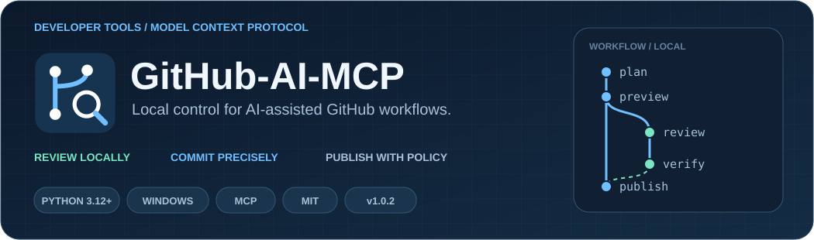
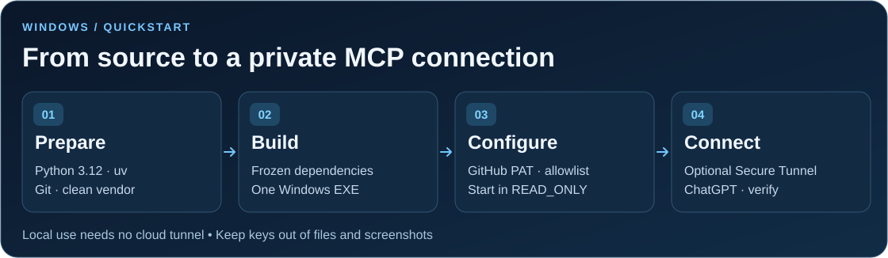
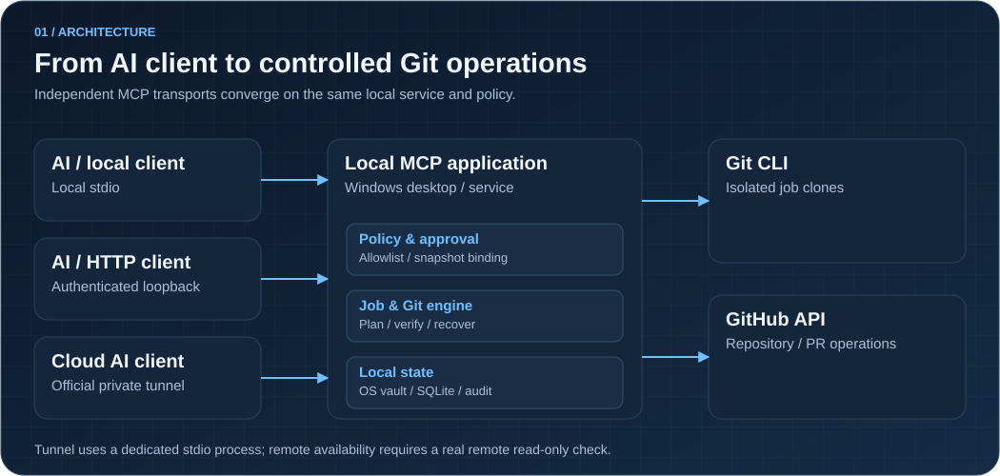
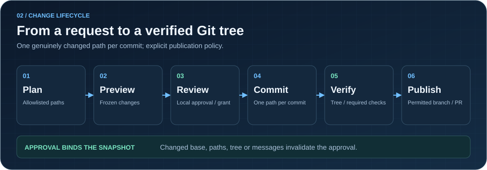
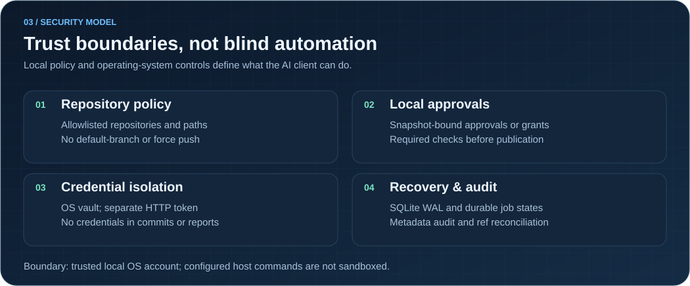

<p align="center">
  
</p>

# GitHub-AI-MCP

<p align="center"><strong>AI-assisted GitHub development, with local review and policy-controlled publication.</strong></p>
<p align="center">
  <a href="README_RU.md">Русский</a> ·
  <a href="docs/QUICKSTART_EN.md">Quickstart</a> ·
  <a href="docs/USER_GUIDE_EN.md">User guide</a> ·
  <a href="docs/API_REFERENCE.md">API reference</a> ·
  <a href="docs/SECURITY_MODEL.md">Security</a> ·
  <a href="LICENSE">MIT license</a>
</p>

---

GitHub-AI-MCP is a desktop application and Model Context Protocol (MCP) server for controlled GitHub development. It combines local review, protected credentials, diagnostics and background service supervision with a policy-enforced Git workflow. It does not include an LLM or require an OpenAI API key for local Git/MCP work.

**Distribution:** one `GitHub-AI-MCP.exe` for Windows. The source project is Python 3.12+; end users of the built EXE need no separate Python or Git installation.

[Getting started](#getting-started) · [Features](#features) · [Architecture](#architecture) · [Workflow](#workflow) · [Security](#security) · [Build on Windows](#build-on-windows) · [Usage](#usage) · [Documentation](#documentation)

## Getting started

[](docs/QUICKSTART_EN.md)

**[Start the step-by-step Windows guide →](docs/QUICKSTART_EN.md)** · [Русская версия](docs/QUICKSTART_RU.md)

| Your goal | Start here |
| --- | --- |
| Build my own Windows EXE | [Tools, downloads and vendor setup](docs/QUICKSTART_EN.md) |
| Use GitHub locally | [First launch and authorization](docs/QUICKSTART_EN.md#4--first-launch-and-github-access) |
| Connect ChatGPT privately | [Secure MCP Tunnel](docs/QUICKSTART_EN.md#5--create-an-optional-private-secure-mcp-tunnel) |

The tunnel is optional for local use. All vendor inputs are required for the current one-file build; public binary availability depends on release and license review.

## Features

| Capability | What it provides |
| :--- | :--- |
| **MCP connectivity** | Local stdio, authenticated loopback Streamable HTTP and an optional existing official Secure MCP Tunnel profile. |
| **Local review** | Preview changes and bind approval to a specific snapshot, paths and messages. |
| **Precise Git history** | Exactly one genuinely changed path per commit; verify the final tree before publication. |
| **Repository policy** | Repository allowlists, path validation, secret detection and controlled push/PR operations. |
| **Desktop control** | Local setup, diagnostics, background service supervision, optional tray and Windows logon startup. |
| **Recovery** | Durable job state, ref reconciliation and metadata audit records. |

## Architecture



The GUI and CLI share the same service; MCP tools are wrappers around its Git and job engines. Local HTTP and tunnel stdio are independent transports. The tunnel is optional and requires an authorized, existing vendor profile. See [architecture](docs/ARCHITECTURE.md) and [MCP connection](docs/MCP_CONNECTION.md).

## Workflow



The engine freezes the desired tree and validates every commit against the approved plan. Publication additionally requires the configured checks, permissions and remote expectations. Default-branch and force pushes are forbidden by the application. No empty commits or fabricated timestamps are produced by the engine. See [commit semantics](docs/COMMIT_SEMANTICS.md) and [branch naming](docs/BRANCH_NAMING.md).

## Security



- GitHub and tunnel credentials use the OS vault; the local HTTP endpoint uses a separate token and binds to loopback.
- MCP tools cannot alter local administration or approvals; sensitive paths and detected credentials are denied.
- Configured host commands are **not sandboxed**. The local OS account is a trusted boundary; secret detection is heuristic.

Read the full [security model](docs/SECURITY_MODEL.md) and [security policy](SECURITY.md) before enabling write access.

## Build on Windows

> [!IMPORTANT]
> Native Windows packaging and live GitHub/tunnel acceptance have not been verified by the original Linux delivery. A passing source suite is not Windows certification. See the [Windows acceptance checklist](docs/WINDOWS_SMOKE_TEST.md).

### 1. Prepare the vendor runtime

Follow [RELEASE_BUILD.md](docs/RELEASE_BUILD.md) for the approved Git, GitHub CLI (`gh`) and official tunnel-client inputs. These binaries are absent from the supplied source archive; the build deliberately fails when an input is missing rather than producing a partial standalone application.

### 2. Build the executable

From the repository root in PowerShell:

```powershell
uv sync --frozen --extra gui --extra dev
uv pip install --python .venv/Scripts/python.exe -r launcher/build-requirements.txt
.venv/Scripts/python.exe scripts/build.py
```

Use `--runtime-dir C:/approved-runtime` on the build command for an external runtime input. The default output is **only** `dist/GitHub-AI-MCP.exe` (no installer, ZIP, checksum/signature report or permanent build tree).

### 3. Launch and configure

Double-click the EXE, open Setup and configure the required services. Logon startup is opt-in and uses one per-user HKCU Run value. After moving the EXE, re-enable startup and repair the tunnel MCP command in Setup. User data stays in place. Closing the window may leave it in the tray; use **Exit** to stop its services.

The same executable dispatches the GUI and internal MCP workers. Vendor resources are extracted automatically to PyInstaller's temporary directory. Configuration, logs and database live in `%LOCALAPPDATA%\GitHub-AI-MCP`; credentials remain in the OS vault.

## Usage

| Task | Entry point |
| :--- | :--- |
| Source desktop development | `.venv/Scripts/python.exe -m github_ai_mcp.desktop.entry` |
| Source test suite | `uv run --frozen --extra gui --extra dev pytest -q` |
| Packaged diagnostics | `GitHub-AI-MCP.exe --cli --config <path> doctor` |
| MCP client setup | [Connection guide](docs/MCP_CONNECTION.md) |

The packaged EXE does not allocate a console; redirect/capture CLI output. Start with read-only operations and verify health before enabling writes. Remote connectivity needs an actual remote read-only invocation, not merely a running tunnel process.

## Documentation

| Getting started | Engineering and trust |
| :--- | :--- |
| [English guide](docs/USER_GUIDE_EN.md) · [Russian guide](docs/USER_GUIDE_RU.md) | [Architecture](docs/ARCHITECTURE.md) |
| [MCP connection](docs/MCP_CONNECTION.md) | [API reference](docs/API_REFERENCE.md) |
| [Release build](docs/RELEASE_BUILD.md) | [Commit semantics](docs/COMMIT_SEMANTICS.md) |
| [Troubleshooting (RU)](docs/TROUBLESHOOTING_RU.md) | [Security model](docs/SECURITY_MODEL.md) |
| [GitHub authentication](docs/GITHUB_AUTH.md) | [Branch naming](docs/BRANCH_NAMING.md) |
| [Windows acceptance](docs/WINDOWS_SMOKE_TEST.md) | [License compliance](docs/LICENSE_COMPLIANCE.md) |

## Community and feedback

Trying GitHub-AI-MCP? Share your experience with the Windows setup or MCP integration in the [early-user feedback thread](https://github.com/fireaideveloper/GitHub-AI-MCP/issues/8). Feature requests and reproducible bug reports are welcome through [Issues](https://github.com/fireaideveloper/GitHub-AI-MCP/issues).

If this project is useful to you, consider starring it on GitHub. Please never include credentials, private repository data or unredacted logs in public feedback.

## Contributing and license

See [CONTRIBUTING.md](CONTRIBUTING.md) and [CHANGELOG.md](CHANGELOG.md). Released under the [MIT license](LICENSE); bundled third-party components have their own licensing obligations.

---

<p align="center"><sub>GitHub-AI-MCP · Local control. Explicit review. Verifiable changes.</sub></p>
