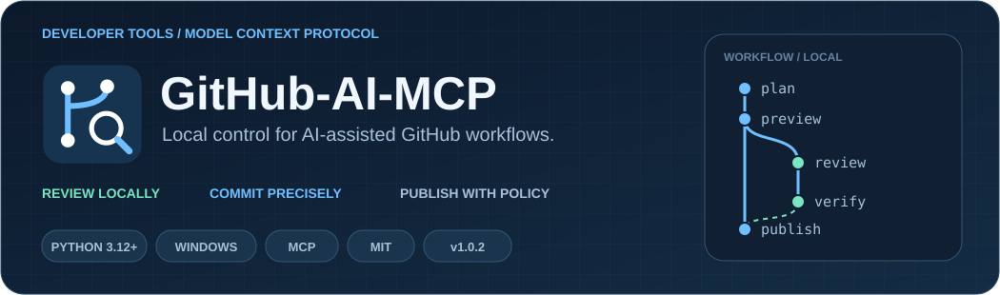
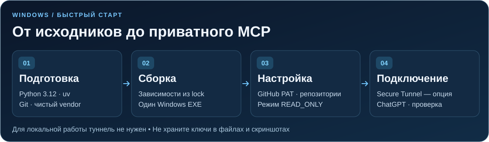
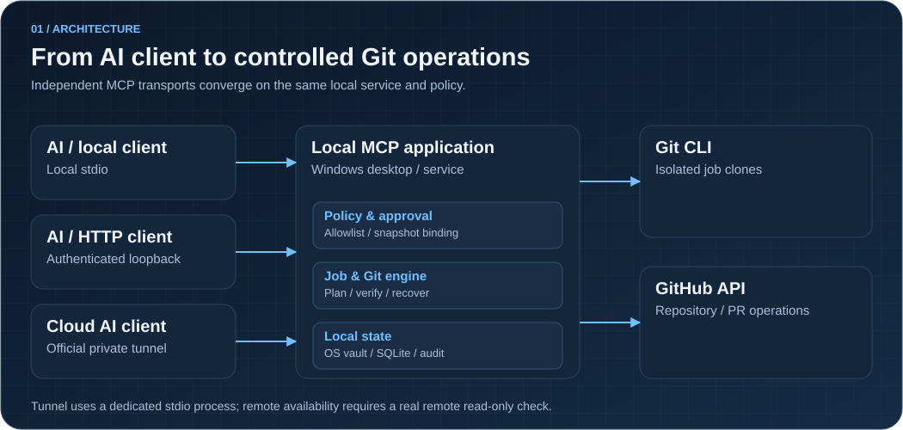
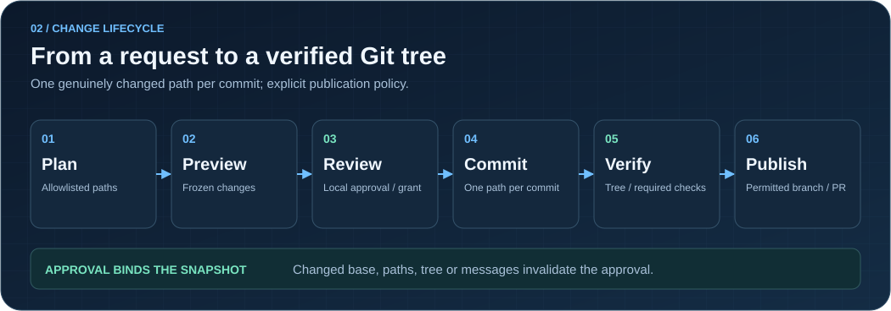
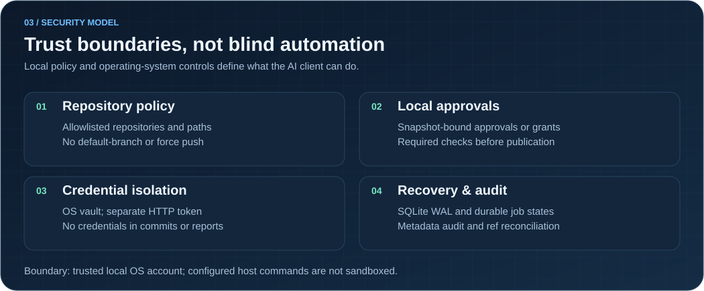

<p align="center">
  
</p>

# GitHub-AI-MCP

<p align="center"><strong>AI-разработка на GitHub с локальной проверкой и контролируемой публикацией.</strong></p>
<p align="center">
  <a href="README.md">English</a> ·
  <a href="docs/QUICKSTART_RU.md">Быстрый старт</a> ·
  <a href="docs/USER_GUIDE_RU.md">Руководство</a> ·
  <a href="docs/API_REFERENCE.md">API</a> ·
  <a href="docs/SECURITY_MODEL.md">Безопасность</a> ·
  <a href="LICENSE">MIT</a>
</p>

---

GitHub-AI-MCP — настольное приложение и сервер Model Context Protocol для управляемой работы AI с GitHub. Оно объединяет локальную проверку изменений, защиту учётных данных, диагностику и управление фоновыми службами. Встроенной языковой модели нет; для локальных операций Git/MCP ключ OpenAI API не требуется.

**Дистрибутив:** один `GitHub-AI-MCP.exe` для Windows. Пользователю готового EXE не нужно отдельно устанавливать Python или Git.

## Быстрый старт

[](docs/QUICKSTART_RU.md)

**[Открыть пошаговую инструкцию Windows →](docs/QUICKSTART_RU.md)** · [English version](docs/QUICKSTART_EN.md)

| Ваша цель | С чего начать |
| --- | --- |
| Собрать собственный EXE | [Инструменты, загрузки и vendor](docs/QUICKSTART_RU.md) |
| Работать с GitHub локально | [Первый запуск и авторизация](docs/QUICKSTART_RU.md#4--первый-запуск-и-доступ-к-github) |
| Подключить ChatGPT приватно | [Secure MCP Tunnel](docs/QUICKSTART_RU.md#5--создайте-необязательный-приватный-secure-mcp-tunnel) |

Для локальной работы туннель необязателен. Текущий сборщик требует все vendor-компоненты; наличие публичного EXE зависит от релиза и лицензионной проверки.

## Возможности

| Компонент | Назначение |
| :--- | :--- |
| **MCP** | Локальный stdio, защищённый loopback HTTP, опциональный официальный приватный туннель с существующим профилем. |
| **Проверка изменений** | Предпросмотр и привязка одобрения к конкретному снимку изменений. |
| **Git** | Один действительно изменённый путь на коммит; проверка итогового дерева. |
| **Политика доступа** | Разрешённые репозитории и пути, проверка секретов, контролируемые push и PR. |
| **Интерфейс** | Настройки, диагностика, фоновые службы, трей и опциональный автозапуск Windows. |
| **Восстановление** | Сохранение состояния заданий, сверка Git-ссылок и метаданные аудита. |

## Архитектура



GUI и CLI используют общий сервис. Локальный HTTP и stdio через туннель независимы. Туннель необязателен и требует существующего авторизованного профиля поставщика. Подробнее: [архитектура](docs/ARCHITECTURE.md), [подключение MCP](docs/MCP_CONNECTION.md).

## Процесс изменений



Движок фиксирует желаемое дерево, проверяет каждый коммит и итоговый результат. Для публикации дополнительно необходимы настроенные проверки, права и соответствие ожидаемому состоянию удалённой ветки. Приложение запрещает push в основную ветку и force-push, не создаёт пустых коммитов и искусственных дат. Подробнее: [семантика коммитов](docs/COMMIT_SEMANTICS.md).

## Безопасность



Учётные данные хранятся в системном хранилище, HTTP использует отдельный токен и привязан к loopback. MCP не предоставляет изменения административных настроек или одобрений. Настроенные команды выполняются на хосте, **не в песочнице**; локальный пользователь ОС — доверенная сторона. Обнаружение секретов эвристическое. См. [модель безопасности](docs/SECURITY_MODEL.md) и [SECURITY.md](SECURITY.md).

## Сборка на Windows

> [!IMPORTANT]
> Это исходный проект. Нативная Windows-сборка и живые проверки GitHub/туннеля не были выполнены при исходной Linux-поставке. Успешные тесты исходников не являются сертификацией Windows. См. [чек-лист](docs/WINDOWS_SMOKE_TEST.md).

1. Подготовьте одобренные Git, GitHub CLI и официальный tunnel-client по [инструкции сборки](docs/RELEASE_BUILD.md). Бинарники не входят в исходный архив; при их отсутствии сборка намеренно завершается ошибкой.
2. Выполните в PowerShell из корня репозитория:

```powershell
uv sync --frozen --extra gui --extra dev
uv pip install --python .venv/Scripts/python.exe -r launcher/build-requirements.txt
.venv/Scripts/python.exe scripts/build.py
```

Внешний набор runtime можно указать через `--runtime-dir C:/approved-runtime`. Результат — только `dist\GitHub-AI-MCP.exe`, без установщиков, дополнительных ZIP и отчётов.

## Запуск

Откройте EXE двойным щелчком и настройте необходимые службы через Setup. Автозапуск включается по желанию пользователя и использует одну запись HKCU Run. После переноса EXE повторно включите автозапуск и исправьте MCP-команду профиля туннеля. Для полной остановки служб используйте Exit, а не только закрытие окна.

Программы из дистрибутива извлекаются автоматически во временную папку PyInstaller; настройки, база и журналы находятся в `%LOCALAPPDATA%\GitHub-AI-MCP`. Секреты остаются в системном хранилище.

| Задача | Команда / инструкция |
| :--- | :--- |
| Запуск из исходников | `.venv/Scripts/python.exe -m github_ai_mcp.desktop.entry` |
| Тесты | `uv run --frozen --extra gui --extra dev pytest -q` |
| Диагностика EXE | `GitHub-AI-MCP.exe --cli --config <path> doctor` |
| Подключение MCP | [Инструкция](docs/MCP_CONNECTION.md) |

EXE не открывает консоль: вывод CLI необходимо перенаправить или захватить. Начинайте с режима чтения; работающий туннель сам по себе не подтверждает доступность удалённого MCP.

## Документация

| Для пользователя | Для разработчика |
| :--- | :--- |
| [Руководство RU](docs/USER_GUIDE_RU.md) · [EN](docs/USER_GUIDE_EN.md) | [Архитектура](docs/ARCHITECTURE.md) |
| [Подключение MCP](docs/MCP_CONNECTION.md) | [Справочник API](docs/API_REFERENCE.md) |
| [Сборка](docs/RELEASE_BUILD.md) | [Семантика коммитов](docs/COMMIT_SEMANTICS.md) |
| [Диагностика](docs/TROUBLESHOOTING_RU.md) | [Модель безопасности](docs/SECURITY_MODEL.md) |
| [Авторизация GitHub](docs/GITHUB_AUTH.md) | [Имена веток](docs/BRANCH_NAMING.md) |
| [Проверка Windows](docs/WINDOWS_SMOKE_TEST.md) | [Лицензии компонентов](docs/LICENSE_COMPLIANCE.md) |

## Сообщество и обратная связь

Попробовали GitHub-AI-MCP? Расскажите об опыте сборки Windows или настройки MCP в [теме обратной связи](https://github.com/fireaideveloper/GitHub-AI-MCP/issues/8). Предложения и воспроизводимые ошибки можно оставлять в [Issues](https://github.com/fireaideveloper/GitHub-AI-MCP/issues).

Если проект оказался полезен, поставьте ему звезду на GitHub. Не публикуйте ключи, данные приватных репозиториев и необработанные журналы.

## Участие в проекте и лицензия

[Правила участия](CONTRIBUTING.md) · [История изменений](CHANGELOG.md) · [MIT](LICENSE). Сторонние компоненты имеют собственные лицензионные условия.

---

<p align="center"><sub>GitHub-AI-MCP · Локальный контроль. Явное одобрение. Проверяемые изменения.</sub></p>
