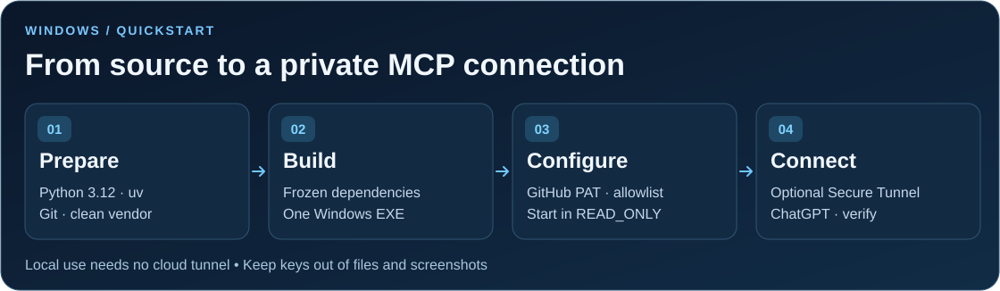

# Windows quickstart

[← Project overview](../README.md) · [Русская версия](QUICKSTART_RU.md) · [Full security model](SECURITY_MODEL.md)



This guide takes you from a clean Windows x64 development machine to a local desktop application and, if your account permits it, a private ChatGPT MCP connection.

> [!IMPORTANT]
> This is a source-build guide, not a claim that a public EXE or every native/cloud integration has been verified. Local Git/MCP work does not require OpenAI access. The current one-file build requires all three vendor inputs, even if you do not plan to use the tunnel. See [native acceptance](WINDOWS_SMOKE_TEST.md) and [license review](LICENSE_COMPLIANCE.md).

## 1 · Install development tools

Install [Python 3.12 x64](https://www.python.org/downloads/windows/) (include the Python launcher and pip) and [Git for Windows](https://git-scm.com/download/win). Open a fresh PowerShell window:

```powershell
py -3.12 --version
git --version
py -3.12 -m pip install uv==0.12.24
py -3.12 -m uv --version
git clone https://github.com/fireaideveloper/GitHub-AI-MCP.git
Set-Location GitHub-AI-MCP
```

If a command is unavailable, reopen PowerShell and check the installation. Python and Git on PATH are development prerequisites; users of a correctly built EXE do not need them separately. See [uv installation alternatives](https://docs.astral.sh/uv/getting-started/installation/).

## 2 · Prepare the clean vendor runtime

Download only from official sources. Select Windows x64/amd64, not ARM64, and record exact releases and publisher checksums where available. Extract into a fresh staging directory first.

| Component | Official download | What to place in the project |
| --- | --- | --- |
| PortableGit | [Git for Windows releases](https://github.com/git-for-windows/git/releases) | Extract the PortableGit x64 self-extracting archive into `vendor/git`; preserve the complete directory layout. Do not copy installed Git. |
| GitHub CLI | [GitHub CLI releases](https://github.com/cli/cli/releases) | Extract the Windows amd64 ZIP, copy `bin/gh.exe` (or the executable at the extracted location) to `vendor/gh.exe`; retain applicable notices. |
| Secure MCP Tunnel | [Official tunnel-client releases](https://github.com/openai/tunnel-client/releases/latest) | Extract the full Windows amd64 client, not a runtime-only or unrelated client. Put `tunnel-client.exe` in `vendor`. Retain required notices; consult provider instructions for companion files. |

```text
vendor/
  git/
    cmd/git.exe
    mingw64/bin/git.exe
    usr/bin/sh.exe
    ... original Git files, notices and helpers
  gh.exe
  tunnel-client.exe
  LICENSES.txt
  ... applicable notices and required resources
```

Use `vendor/LICENSES.txt` to record versions, original URLs, relative paths, SHA-256, license notices and source/offer information. Do not put absolute paths to your user directory in the manifest. See [build inputs](RELEASE_BUILD.md) and [distribution obligations](LICENSE_COMPLIANCE.md). Do not copy installed Git uninstall files (`unins000.*`), personal YAML profiles, .gitconfig, credentials, databases, logs or keys. This directory is embedded in the EXE.

```powershell
& .\vendor\git\cmd\git.exe --version
& .\vendor\gh.exe --version
& .\vendor\tunnel-client.exe --version
& .\vendor\tunnel-client.exe help quickstart
Get-FileHash .\vendor\git\cmd\git.exe, .\vendor\gh.exe, .\vendor\tunnel-client.exe -Algorithm SHA256 |
  Select-Object Hash, @{Name='File';Expression={Split-Path $_.Path -Leaf}}
```

Keep the full PortableGit tree. A missing input is a build error; a PE header or a hash alone does not establish safety or redistribution rights.

## 3 · Build and test

From the repository root:

```powershell
py -3.12 -m uv sync --python 3.12 --frozen --extra gui --extra dev
py -3.12 -m uv pip install --python .venv/Scripts/python.exe -r launcher/build-requirements.txt
& .\.venv\Scripts\python.exe scripts/build.py
Get-FileHash .\dist\GitHub-AI-MCP.exe -Algorithm SHA256
```

Output: `dist/GitHub-AI-MCP.exe`. To use an external reviewed vendor folder, add `--runtime-dir C:/approved-runtime` to the build command. The output folder must contain no unrelated files.

```powershell
$env:QT_QPA_PLATFORM = 'offscreen'
& .\.venv\Scripts\python.exe -m pytest -q
& .\.venv\Scripts\python.exe -m ruff check .
& .\.venv\Scripts\python.exe -m mypy src
Remove-Item Env:QT_QPA_PLATFORM -ErrorAction SilentlyContinue
```

For packaged smoke checks, follow [WINDOWS_SMOKE_TEST.md](WINDOWS_SMOKE_TEST.md) on an isolated Windows account. Do not publish a binary until its embedded contents, licenses, and native behavior have been reviewed.

## 4 · First launch and GitHub access

Double-click the EXE. For local-only exploration, choose **Explore without configuring integrations** or leave the optional tunnel disabled. Settings, database and logs live under `%LOCALAPPDATA%\GitHub-AI-MCP`; keys are stored in the OS vault.

1. In GitHub [fine-grained token settings](https://github.com/settings/personal-access-tokens), create a limited-expiry token for only the repositories you intend to use. Read access needs Contents read; publication additionally needs appropriate write permissions.
2. Enter the PAT in the application's GitHub login dialog, not in Git or a config file. The packaged application supplies its vault token to the GitHub CLI child process; separate `gh auth login` is not required for this workflow.
3. In application Settings, add an allowlisted repository using its canonical HTTPS URL, authorize the intended identity, and use an appropriate verified or GitHub noreply author email. Begin in `READ_ONLY`.
4. Use diagnostics and a read-only repository listing to verify access. The app does not grant GitHub permissions by itself.

[GitHub authentication details](GITHUB_AUTH.md) · [Security boundaries](SECURITY_MODEL.md)

## 5 · Create an optional private Secure MCP Tunnel

Skip this section for local-only use. A tunnel does not expose your local HTTP port publicly. You need authorized access to a Platform organization and the target ChatGPT workspace.

- Open [Platform tunnel settings](https://platform.openai.com/settings/organization/tunnels). Create or reuse a tunnel and associate it with the intended ChatGPT workspace as well as the relevant Platform organization.
- Creation needs Tunnels Read + Manage; operation and selection need Read + Use. Obtain a dedicated runtime key with the required permissions. A subscription alone does not guarantee this access.
- Keep the tunnel ID and key locally. The runtime key is different from the GitHub PAT, model API credential, and local HTTP MCP token.

### Initialize a profile

Use the full official client extracted in step 2. Open Setup in the running EXE and use **Use current application command**, then **Copy stdio command**. This produces the exact quoted command for your actual EXE and configuration (the worker uses `--internal-server`). In PowerShell from the project root:

```powershell
$client = (Resolve-Path .\vendor\tunnel-client.exe).Path
& $client help quickstart
$tunnelId = Read-Host 'Your tunnel ID'
$mcpCommand = Read-Host 'Paste the copied stdio command'
& $client init --sample sample_mcp_stdio_local --profile github-ai-local --tunnel-id $tunnelId --mcp-command $mcpCommand
```

Use the generated YAML path reported by the client, or locate the named profile according to its help. If your client requires a runtime key during initialization, follow its official secure input instructions; never write a literal key in the command, transcript, YAML, or repository. The application's profile must use `control_plane.api_key: env:CONTROL_PLANE_API_KEY` and one main stdio command. The installed client defines the exact schema; do not hand-build it from an assumed sample.

### Configure the desktop application

| Setup control | Action |
| --- | --- |
| Tunnel executable | Use the bundled client or browse to the reviewed external full client. |
| Profile / Select YAML | Use `github-ai-local` and select the generated YAML file. |
| Runtime key | Enter the key in the password field and save it to the OS vault. |
| Use current application command | Restore the correct command for this EXE. |
| Repair MCP command (with backup) | Update the main command in the selected YAML; save. |
| Validate profile and key | Run doctor; fix any error before starting the service. |
| Start optional tunnel automatically | Enable only if wanted; start the tunnel in Services. |

Do not start a second unmanaged copy of the same tunnel. Leave the local HTTP service disabled if it is not needed; it is independent of the tunnel's stdio server.

## 6 · Connect and verify in ChatGPT

In an eligible workspace, open [ChatGPT Plugins](https://chatgpt.com/#settings/Connectors), select the option to add a custom MCP server, choose **Tunnel**, and select the same associated tunnel (or supply its ID). Follow the current authentication and risk prompts. If the option is absent, check the workspace and Platform permissions instead of exposing your local endpoint.

Start with these read-only tools: `health_check` and `list_repositories` (names may be prefixed by the client). Verify the returned data matches your allowlist. Only then consider write modes and explicit local approvals. A green local process alone does not prove a working remote MCP call.

Official references: [Secure MCP Tunnel](https://developers.openai.com/api/docs/guides/secure-mcp-tunnels) · [client onboarding](https://github.com/openai/tunnel-client/blob/master/docs/onboarding.md) · [MCP connection details](MCP_CONNECTION.md).

## 7 · Optional startup and troubleshooting

After a successful run, use Setup to enable Windows sign-in startup, service startup and tray behavior if desired. Save and validate startup. If you move the EXE, repair both startup and the profile command. Use **Exit** to stop owned services.

| Symptom | First action |
| --- | --- |
| Missing build input | Check the vendor tree against step 2. |
| No tunnel option in ChatGPT | Verify workspace association and permissions. |
| MCP_COMMAND | Restore and repair the stdio command in Setup. |
| DOCTOR_FAILED / TUNNEL_KEY_MISSING | Check profile, runtime key, permissions and network; do not publish raw logs. |
| Local green, remote fails | Check client readiness and make a real read-only remote invocation. |
| Windows startup fails | Revalidate registration after moving the EXE. |

[Russian troubleshooting](TROUBLESHOOTING_RU.md) · [English user guide](USER_GUIDE_EN.md) · [API reference](API_REFERENCE.md)

---
**Success criteria:** a built EXE, a read-only local check, and (if enabled) a successful remote MCP read. Keep all private credentials out of screenshots and public releases.
