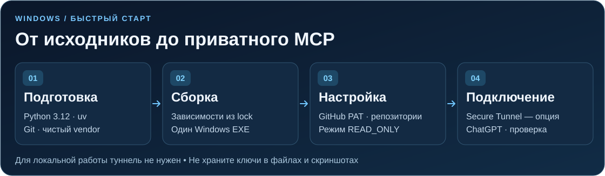

# Быстрый старт на Windows

[← О проекте](../README_RU.md) · [English version](QUICKSTART_EN.md) · [Модель безопасности](SECURITY_MODEL.md)



Путь от чистого Windows x64 до собственного EXE и приватного подключения MCP к ChatGPT, если это разрешено вашей учётной записью.

> [!IMPORTANT]
> Это руководство по сборке исходников, а не подтверждение публикации готового EXE или прохождения всех нативных проверок. Для локальной работы OpenAI не нужен. Текущий сборщик требует все три vendor-компонента, даже если вы не собираетесь пользоваться туннелем. См. [проверку Windows](WINDOWS_SMOKE_TEST.md) и [лицензирование](LICENSE_COMPLIANCE.md).

## 1 · Установите инструменты разработчика

Установите [Python 3.12 x64](https://www.python.org/downloads/windows/) с launcher и pip, а также [Git for Windows](https://git-scm.com/download/win). Откройте новое окно PowerShell:

```powershell
py -3.12 --version
git --version
py -3.12 -m pip install uv==0.12.24
py -3.12 -m uv --version
git clone https://github.com/fireaideveloper/GitHub-AI-MCP.git
Set-Location GitHub-AI-MCP
```

Если команда не найдена, проверьте установку и перезапустите PowerShell. Пользователю правильно собранного EXE отдельно устанавливать Python и Git не требуется. [Другие способы установки uv](https://docs.astral.sh/uv/getting-started/installation/).

## 2 · Подготовьте чистую папку vendor

Скачивайте файлы из официальных источников. Выберите Windows x64/amd64, а не ARM64, запишите точные версии и проверьте опубликованные контрольные суммы, если доступны. Распакуйте компоненты в отдельную чистую папку.

| Компонент | Скачать | Куда поместить |
| --- | --- | --- |
| PortableGit | [Релизы Git for Windows](https://github.com/git-for-windows/git/releases) | Распаковать самораспаковывающийся PortableGit x64 в `vendor/git`, сохранив полную структуру. Не копировать установленный Git. |
| GitHub CLI | [Релизы GitHub CLI](https://github.com/cli/cli/releases) | Распаковать ZIP для Windows amd64, скопировать `bin/gh.exe` (или EXE из фактической папки распаковки) в `vendor/gh.exe` и сохранить применимые уведомления. |
| Secure MCP Tunnel | [Официальный tunnel-client](https://github.com/openai/tunnel-client/releases/latest) | Распаковать полный клиент Windows amd64, не сокращённый runtime. Поместить `tunnel-client.exe` в `vendor`. Сохранить лицензионные уведомления и сверить требования к сопутствующим файлам. |

```text
vendor/
  git/
    cmd/git.exe
    mingw64/bin/git.exe
    usr/bin/sh.exe
    ... оригинальные библиотеки и файлы Git
  gh.exe
  tunnel-client.exe
  LICENSES.txt
  ... лицензионные уведомления и нужные ресурсы
```

В `vendor/LICENSES.txt` внесите версии, исходные URL, относительные пути, SHA-256, лицензионные сведения и информацию о соответствующих исходниках/предложениях исходников. Не записывайте абсолютные пути с именем пользователя. См. [требования сборки](RELEASE_BUILD.md) и [лицензирование](LICENSE_COMPLIANCE.md). Не переносите деинсталлятор установленного Git (`unins000.*`), личные YAML-профили, .gitconfig, ключи, базы и журналы. Папка встраивается в EXE.

```powershell
& .\vendor\git\cmd\git.exe --version
& .\vendor\gh.exe --version
& .\vendor\tunnel-client.exe --version
& .\vendor\tunnel-client.exe help quickstart
Get-FileHash .\vendor\git\cmd\git.exe, .\vendor\gh.exe, .\vendor\tunnel-client.exe -Algorithm SHA256 |
  Select-Object Hash, @{Name='File';Expression={Split-Path $_.Path -Leaf}}
```

Не удаляйте остальные файлы PortableGit. Наличие PE-заголовка и хеша не доказывает безопасность или право распространения.

## 3 · Соберите EXE и проверьте исходники

Из корня репозитория:

```powershell
py -3.12 -m uv sync --python 3.12 --frozen --extra gui --extra dev
py -3.12 -m uv pip install --python .venv/Scripts/python.exe -r launcher/build-requirements.txt
& .\.venv\Scripts\python.exe scripts/build.py
Get-FileHash .\dist\GitHub-AI-MCP.exe -Algorithm SHA256
```

Результат — `dist/GitHub-AI-MCP.exe`. Если одобренные компоненты находятся вне репозитория, добавьте к команде сборки `--runtime-dir C:/approved-runtime`. В папке результата не должно быть посторонних файлов.

```powershell
$env:QT_QPA_PLATFORM = 'offscreen'
& .\.venv\Scripts\python.exe -m pytest -q
& .\.venv\Scripts\python.exe -m ruff check .
& .\.venv\Scripts\python.exe -m mypy src
Remove-Item Env:QT_QPA_PLATFORM -ErrorAction SilentlyContinue
```

Проверку готового EXE проводите по [чек-листу Windows](WINDOWS_SMOKE_TEST.md) в отдельной учётной записи. Перед распространением проверьте содержимое бинарника, лицензии и нативное поведение.

## 4 · Первый запуск и доступ к GitHub

Откройте EXE двойным щелчком. Для локального знакомства выберите **Продолжить без настройки интеграций** или отключите необязательный туннель. Настройки, база и журналы расположены в `%LOCALAPPDATA%\GitHub-AI-MCP`, ключи — в хранилище ОС.

1. В [настройках fine-grained PAT GitHub](https://github.com/settings/personal-access-tokens) создайте токен с ограниченным сроком действия и доступом только к нужным репозиториям. Для чтения — Contents read; публикация требует соответствующих прав записи.
2. Введите PAT в диалоге входа GitHub приложения, а не в JSON или Git. Приложение передаёт ключ из хранилища дочернему GitHub CLI; отдельный `gh auth login` в этом сценарии не нужен.
3. В настройках приложения добавьте разрешённый репозиторий с каноническим HTTPS URL, подтвердите авторство и укажите подходящий подтверждённый или noreply email GitHub. Начните с `READ_ONLY`.
4. Проверьте диагностику и получение списка разрешённых репозиториев. Само приложение не выдаёт права на GitHub.

[Авторизация GitHub](GITHUB_AUTH.md) · [Модель безопасности](SECURITY_MODEL.md)

## 5 · Создайте необязательный приватный Secure MCP Tunnel

Для локальной работы этот этап можно пропустить. Туннель не открывает локальный HTTP-порт в интернете. Нужен разрешённый доступ к организации Platform и рабочему пространству ChatGPT.

- Откройте [настройки туннелей Platform](https://platform.openai.com/settings/organization/tunnels). Создайте или выберите существующий туннель, свяжите его с нужным workspace ChatGPT и соответствующей организацией Platform.
- Для создания нужны Tunnels Read + Manage, для использования и выбора — Read + Use. Получите отдельный runtime key с необходимыми правами. Подписка ChatGPT сама по себе не гарантирует доступ.
- Храните ID и ключ локально. Runtime key отличается от GitHub PAT, ключа модели OpenAI и токена локального HTTP MCP.

### Создайте YAML-профиль

Используйте полный официальный клиент из шага 2. В настройках запущенного EXE нажмите **Подставить команду текущей программы**, затем **Скопировать команду stdio**. Получится точная команда для вашего EXE и config с параметром `--internal-server`. В PowerShell из корня проекта:

```powershell
$client = (Resolve-Path .\vendor\tunnel-client.exe).Path
& $client help quickstart
$tunnelId = Read-Host 'Ваш tunnel ID'
$mcpCommand = Read-Host 'Вставьте скопированную команду stdio'
& $client init --sample sample_mcp_stdio_local --profile github-ai-local --tunnel-id $tunnelId --mcp-command $mcpCommand
```

Используйте путь к созданному YAML из вывода клиента или найдите профиль согласно справке. Если при инициализации клиент запрашивает runtime key, используйте официальный безопасный способ ввода; не вставляйте ключ в команду, историю, YAML или репозиторий. Приложению нужна ссылка `control_plane.api_key: env:CONTROL_PLANE_API_KEY` и одна основная команда stdio. Точную схему определяет установленный клиент.

### Настройте приложение

| Элемент Setup | Действие |
| --- | --- |
| Исполняемый файл туннеля | Используйте встроенный клиент или выберите проверенный внешний полный клиент. |
| Профиль / Выбрать YAML | Укажите `github-ai-local` и созданный YAML. |
| Runtime key | Введите ключ в поле пароля и сохраните в хранилище ОС. |
| Подставить команду текущей программы | Восстановите команду именно текущего EXE. |
| Исправить команду MCP (с резервной копией) | Обновите команду main и сохраните. |
| Проверить профиль и ключ | Выполните doctor; исправьте ошибку до запуска. |
| Автоматически запускать туннель | При необходимости включите и запустите туннель в разделе служб. |

Не запускайте второй внешний экземпляр того же туннеля. Локальный HTTP MCP и stdio туннеля независимы: HTTP можно оставить отключённым, если он не требуется.

## 6 · Подключите ChatGPT и проверьте результат

В доступном рабочем пространстве откройте [ChatGPT](https://chatgpt.com/) → Plugins, выберите добавление собственного MCP-сервера и тип соединения **Tunnel**. Выберите связанный туннель или укажите его ID, пройдите актуальные шаги авторизации и ознакомьтесь с предупреждением. Если опции нет, проверьте права и привязку workspace, а не открывайте локальный порт наружу.

Сначала вызовите инструменты чтения `health_check` и `list_repositories` (клиент может добавлять префикс). Убедитесь, что возвращаются ожидаемые данные разрешённых репозиториев. Только затем рассматривайте режимы записи и локальные одобрения. Зелёный индикатор процесса не заменяет настоящий удалённый вызов.

Официальные источники: [Secure MCP Tunnel](https://developers.openai.com/api/docs/guides/secure-mcp-tunnels) · [онбординг клиента](https://github.com/openai/tunnel-client/blob/master/docs/onboarding.md) · [подключение MCP](MCP_CONNECTION.md).

## 7 · Автозапуск и устранение ошибок

После успешной проверки в Setup можно включить запуск при входе в Windows, запуск служб и трей. Сохраните настройки и проверьте автозапуск. После перемещения EXE исправьте регистрацию и команду профиля. Для остановки своих служб используйте **Выход**.

| Симптом | Что проверить |
| --- | --- |
| Missing build input | Структуру vendor из шага 2. |
| Нет Tunnel в ChatGPT | Привязку рабочего пространства и права. |
| MCP_COMMAND | Подстановку и исправление stdio-команды в Setup. |
| DOCTOR_FAILED / TUNNEL_KEY_MISSING | Профиль, ключ, права и сеть; не публикуйте сырые журналы. |
| Локально зелёный, удалённо не работает | Готовность клиента и настоящий удалённый вызов чтения. |
| Не работает автозапуск | Повторную проверку регистрации после переноса EXE. |

[Устранение ошибок](TROUBLESHOOTING_RU.md) · [Руководство пользователя](USER_GUIDE_RU.md) · [Справочник API](API_REFERENCE.md)

---
**Критерии успеха:** собранный EXE, локальная проверка чтения и (если подключён туннель) успешный удалённый вызов MCP. Не публикуйте личные ключи и данные в скриншотах и релизах.
